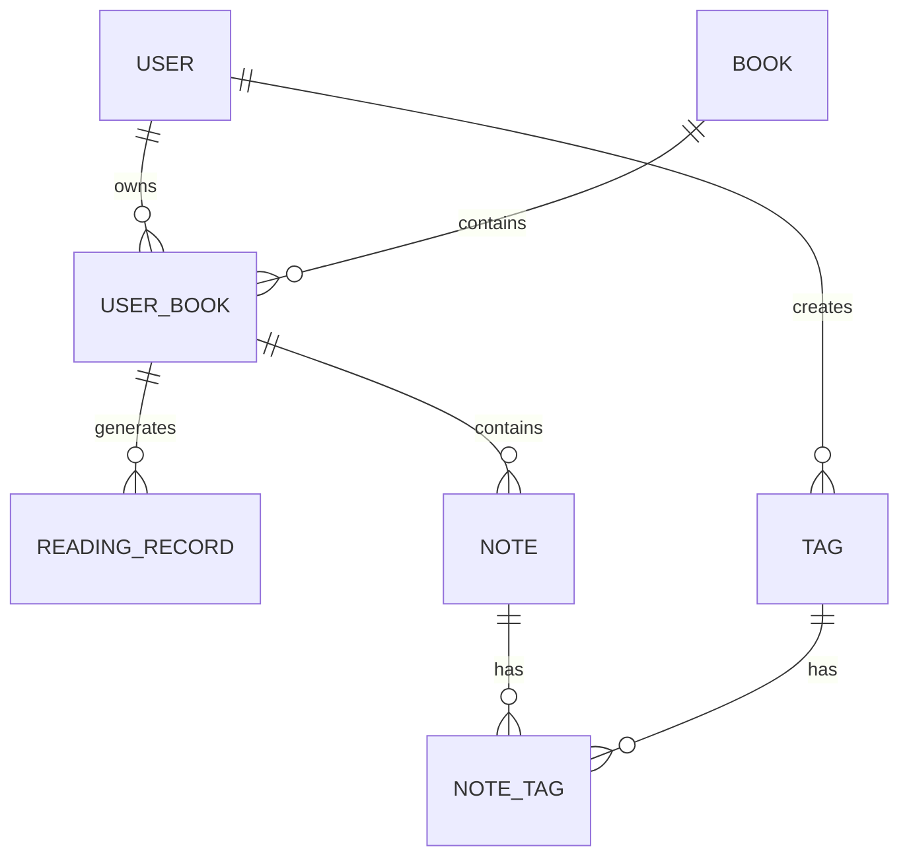

# 数据库设计

## 1. 设计说明

纸书手记 V1 使用 MySQL 8，数据库设计遵循以下约定：

- 表名和字段名使用小写英文与下划线。
- 主键统一使用 `BIGINT UNSIGNED`。
- 时间字段使用 `DATETIME`。
- 数据库引擎使用 `InnoDB`。
- 字符集使用 `utf8mb4`。
- 密码只保存密码摘要，不保存明文。
- 从书架移除书籍时，相关阅读记录和笔记永久删除。

## 2. ER 图



### 实体中文说明

| 实体 | 中文名称 |
|---|---|
| `USER` | 用户 |
| `BOOK` | 书籍 |
| `USER_BOOK` | 用户书架 |
| `READING_RECORD` | 阅读记录 |
| `NOTE` | 笔记 |
| `TAG` | 标签 |
| `NOTE_TAG` | 笔记标签关联 |

## 3. 数据表设计

### 3.1 用户表 `users`

用于保存用户账户和登录信息。

| 字段 | 类型 | 约束 | 说明 |
|---|---|---|---|
| `id` | BIGINT UNSIGNED | PK、自增 | 用户ID |
| `username` | VARCHAR(50) | NOT NULL | 用户名 |
| `email` | VARCHAR(255) | NOT NULL、UNIQUE | 登录邮箱 |
| `password_hash` | VARCHAR(255) | NOT NULL | 密码摘要 |
| `status` | VARCHAR(20) | NOT NULL、默认 `ACTIVE` | 账户状态 |
| `created_at` | DATETIME | NOT NULL | 创建时间 |
| `updated_at` | DATETIME | NOT NULL | 更新时间 |

账户状态：

| 状态 | 说明 |
|---|---|
| `ACTIVE` | 正常 |
| `DISABLED` | 已禁用 |

业务规则：

- 邮箱保存前统一转换为小写。
- 邮箱不能重复注册。
- 密码必须经过安全算法处理后保存。
- 接口不能返回 `password_hash`。

### 3.2 书籍表 `books`

用于保存书籍的基础信息，不保存具体用户的阅读状态。

| 字段 | 类型 | 约束 | 说明 |
|---|---|---|---|
| `id` | BIGINT UNSIGNED | PK、自增 | 书籍ID |
| `isbn` | VARCHAR(20) | UNIQUE、可为空 | ISBN |
| `title` | VARCHAR(255) | NOT NULL | 书名 |
| `author` | VARCHAR(255) | 可为空 | 作者 |
| `publisher` | VARCHAR(255) | 可为空 | 出版社 |
| `publish_date` | DATE | 可为空 | 出版日期 |
| `cover_url` | VARCHAR(500) | 可为空 | 封面地址 |
| `total_pages` | INT UNSIGNED | 可为空 | 总页数 |
| `created_at` | DATETIME | NOT NULL | 创建时间 |
| `updated_at` | DATETIME | NOT NULL | 更新时间 |

业务规则：

- 书名必填。
- ISBN填写时不能重复。
- 总页数必须大于0。
- 总页数未知时允许为空。
- 阅读进度不能放在本表，因为不同用户的阅读进度不同。

### 3.3 用户书架表 `user_books`

用于保存用户与书籍之间的关系及阅读状态。

| 字段 | 类型 | 约束 | 说明 |
|---|---|---|---|
| `id` | BIGINT UNSIGNED | PK、自增 | 书架记录ID |
| `user_id` | BIGINT UNSIGNED | FK、NOT NULL | 用户ID |
| `book_id` | BIGINT UNSIGNED | FK、NOT NULL | 书籍ID |
| `reading_status` | VARCHAR(20) | NOT NULL | 阅读状态 |
| `current_page` | INT UNSIGNED | NOT NULL、默认0 | 当前页码 |
| `started_at` | DATE | 可为空 | 开始阅读日期 |
| `finished_at` | DATE | 可为空 | 完成阅读日期 |
| `rating` | TINYINT UNSIGNED | 可为空 | 用户评分 |
| `created_at` | DATETIME | NOT NULL | 加入书架时间 |
| `updated_at` | DATETIME | NOT NULL | 更新时间 |

阅读状态：

| 状态 | 说明 |
|---|---|
| `WANT_TO_READ` | 想读 |
| `READING` | 在读 |
| `FINISHED` | 读完 |
| `PAUSED` | 搁置 |

业务规则：

- `user_id + book_id`必须联合唯一。
- 同一本书不能重复加入同一用户的书架。
- 当前页码不能超过书籍总页数。
- 评分范围为1～5分。
- 删除书架记录时，级联删除阅读记录和笔记。

### 3.4 阅读记录表 `reading_records`

用于记录用户每次阅读的页码、时间和时长。

| 字段 | 类型 | 约束 | 说明 |
|---|---|---|---|
| `id` | BIGINT UNSIGNED | PK、自增 | 阅读记录ID |
| `user_book_id` | BIGINT UNSIGNED | FK、NOT NULL | 用户书架记录ID |
| `start_page` | INT UNSIGNED | NOT NULL | 开始页码 |
| `end_page` | INT UNSIGNED | NOT NULL | 结束页码 |
| `duration_minutes` | INT UNSIGNED | 可为空 | 阅读时长，单位分钟 |
| `read_at` | DATETIME | NOT NULL | 阅读发生时间 |
| `remark` | VARCHAR(500) | 可为空 | 备注 |
| `created_at` | DATETIME | NOT NULL | 创建时间 |

业务规则：

- 结束页码不能小于开始页码。
- 页码不能超过书籍总页数。
- 阅读页数可以根据开始页码和结束页码计算。
- 删除用户书架记录时，相关阅读记录级联删除。

### 3.5 笔记表 `notes`

用于保存摘录和个人想法。

| 字段 | 类型 | 约束 | 说明 |
|---|---|---|---|
| `id` | BIGINT UNSIGNED | PK、自增 | 笔记ID |
| `user_book_id` | BIGINT UNSIGNED | FK、NOT NULL | 用户书架记录ID |
| `note_type` | VARCHAR(20) | NOT NULL | 笔记类型 |
| `content` | TEXT | NOT NULL | 笔记内容 |
| `page_number` | INT UNSIGNED | 可为空 | 所在页码 |
| `chapter` | VARCHAR(255) | 可为空 | 章节名称 |
| `created_at` | DATETIME | NOT NULL | 创建时间 |
| `updated_at` | DATETIME | NOT NULL | 更新时间 |

笔记类型：

| 类型 | 说明 |
|---|---|
| `QUOTE` | 摘录 |
| `THOUGHT` | 想法 |

业务规则：

- 笔记内容不能为空。
- 页码必须大于0。
- 页码不能超过书籍总页数。
- 用户只能操作自己书架下的笔记。
- 删除笔记时，级联删除笔记标签关联。

### 3.6 标签表 `tags`

用于保存用户创建的标签。

| 字段 | 类型 | 约束 | 说明 |
|---|---|---|---|
| `id` | BIGINT UNSIGNED | PK、自增 | 标签ID |
| `user_id` | BIGINT UNSIGNED | FK、NOT NULL | 用户ID |
| `name` | VARCHAR(50) | NOT NULL | 标签名称 |
| `created_at` | DATETIME | NOT NULL | 创建时间 |
| `updated_at` | DATETIME | NOT NULL | 更新时间 |

业务规则：

- `user_id + name`必须联合唯一。
- 同一用户不能创建同名标签。
- 不同用户可以创建同名标签。
- 删除标签时，只删除标签关联，不删除笔记。

### 3.7 笔记标签关联表 `note_tags`

用于实现笔记与标签之间的多对多关系。

| 字段 | 类型 | 约束 | 说明 |
|---|---|---|---|
| `note_id` | BIGINT UNSIGNED | PK、FK | 笔记ID |
| `tag_id` | BIGINT UNSIGNED | PK、FK | 标签ID |
| `created_at` | DATETIME | NOT NULL | 关联创建时间 |

业务规则：

- `note_id + tag_id`组成联合主键。
- 同一笔记不能重复关联同一标签。
- 删除笔记时，关联记录级联删除。
- 删除标签时，关联记录级联删除。
- 关联标签时，必须验证笔记和标签属于同一用户。

## 4. 外键与删除规则

| 父表 | 子表 | 删除规则 | 说明 |
|---|---|---|---|
| `users` | `user_books` | CASCADE | 删除用户时删除其书架 |
| `users` | `tags` | CASCADE | 删除用户时删除其标签 |
| `books` | `user_books` | RESTRICT | 书籍被使用时禁止删除 |
| `user_books` | `reading_records` | CASCADE | 移除书籍时删除阅读记录 |
| `user_books` | `notes` | CASCADE | 移除书籍时删除笔记 |
| `notes` | `note_tags` | CASCADE | 删除笔记时删除标签关联 |
| `tags` | `note_tags` | CASCADE | 删除标签时删除标签关联 |

## 5. 唯一约束

```text
UNIQUE(users.email)
UNIQUE(books.isbn)
UNIQUE(user_books.user_id, user_books.book_id)
UNIQUE(tags.user_id, tags.name)
PRIMARY KEY(note_tags.note_id, note_tags.tag_id)
```

## 6. 推荐索引

```text
INDEX user_books(user_id, reading_status)
INDEX reading_records(user_book_id, read_at)
INDEX notes(user_book_id, created_at)
INDEX tags(user_id)
INDEX note_tags(tag_id)
```

## 7. 关键词查询

V1使用MySQL的模糊查询实现笔记关键词搜索：

```sql
SELECT *
FROM notes
WHERE content LIKE CONCAT('%', :keyword, '%')
   OR chapter LIKE CONCAT('%', :keyword, '%');
```

第一版数据量较小，暂时不引入 Elasticsearch。

## 8. 删除书架记录流程

当用户从书架移除书籍时，系统执行以下操作：

1. 验证书架记录属于当前用户。
2. 提示用户阅读记录和笔记将永久删除。
3. 用户二次确认。
4. 删除 `user_books` 记录。
5. 数据库级联删除 `reading_records`。
6. 数据库级联删除 `notes`。
7. 数据库级联删除相关 `note_tags`。
8. 保留书籍基础信息和标签信息。

整个删除操作必须在同一个数据库事务中执行。

## 9. 最终数据关系

```text
用户
├── 用户书架
│   ├── 阅读记录
│   └── 笔记
│       └── 笔记标签关联
└── 标签
    └── 笔记标签关联

书籍
└── 用户书架
```
